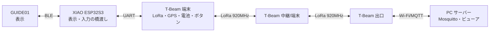

# ARCHITECTURE — 構成とデータの流れ

## 1. 全体像



- 端末は中継も兼ねる(企画書の「端末間リレー」)。
- 出口は、サーバーに到達できる T-Beam。試作では Wi-Fi(スマホのテザリングまたは AP)でサーバーへつなぐ。将来は SIM 対応の出口ユニットに置き換える(p-02 の対象外)。

## 2. 3層のフェイルオーバー

| 層 | 状態 | 動き | p-02 での扱い |
|---|---|---|---|
| 1 | Wi-Fi とサーバーが生きている | 出口経由で MQTT。全機能 | S5 |
| 2 | 回線が落ちている | LoRa の中継で定型信号を運ぶ。出口があればサーバーへ | S4, S5 |
| 3 | 出口が1台もない | 近くの端末同士で共有し、保存。回復時にまとめて送る | S4(共有まで)。保存と再送は任意 |

## 3. データの流れ

### 上り(現場 → 本部)

1. 端末のボタンで定型報告を作る(区域、人数の区分、怪我人、要救助、必要物資、SOS)
2. T-Beam が署名つきフレームを作り、LoRa で送信(`MESSAGE_SPEC.md`)
3. 近くの端末・中継が重複排除して再送(`RELAY_DESIGN.md`)
4. 出口が受信し、MQTT で PC へ。PC が保存・表示
5. 出口が「サーバー到達」の ACK を LoRa で返す
6. 送った端末が ACK を受け、グラスの表示を「サーバー到達」に更新

### 下り(本部 → 現場)

1. PC の指示(個別・区域・全体)を MQTT で出口へ
2. 出口が指示フレーム(署名つき)を LoRa で放送
3. 端末・中継が再送。受信した端末は、グラスに表示
4. 端末は「指示受領」の ACK を返す(ボタンで確認する方式も試す)
5. PC が、受領した端末と未受領の端末を一覧で見る

## 4. 状態表示(送った本人に分かるように)

送信した報告には、次の3段階の状態を持たせる。

| 状態 | 意味 |
|---|---|
| 送信済み | 自分の LoRa から送り出した |
| 近傍に届いた | 他のノードの再送を聞いた、または近傍の ACK を受けた |
| サーバー到達 | 出口からの ACK を受けた |
| 未達(再送中) | 一定時間 ACK がなく、再送している |

## 5. T-Beam ⇄ XIAO の UART 仕様(案)

1行1メッセージの、改行区切りテキスト。115200bps、8N1。
配線案(XIAO D6/D7 = GPIO43/44、T-Beam GPIO13/14)は `docs/PINMAP.md`。T-Beam 側のヘッダ位置と XIAO の論理レベルは実機で確認してから確定する。
実装は `firmware/shared/include/reray/uart_proto.h`(行の形式と行バッファ。テスト済み)。

T-Beam → XIAO(表示用)

```
STATE,<seq>,<state>          送信した報告の状態(SENT / NEAR / SERVER / RETRY / FAIL=未達で再送を打ち切った)
INSTR,<seq>,<code>,<param>   受信した指示
STATUS,<batt%>,<zone>,<role>,<lora_ok>,<wifi_ok>
LOG,<text>                   表示したい短い文
```

XIAO → T-Beam(入力用)

```
BTN,<id>                     グラス側のタッチ、または XIAO 側の入力(取れる場合のみ)
ACK_INSTR,<seq>              指示を確認した
```

ボタンでの報告入力は、T-Beam 側の物理ボタンで行う(IO38 と外付けボタン)。グラスのタッチが取得できれば、補助として使う(S1 の結果次第)。

## 6. グラスの表示(案)

文字数・行数は S1 で実測してから確定する。

```
[区域3] 電池82%  LoRa● Wi-Fi○
最新の指示: 区域5へ物資搬送
報告#12: サーバー到達
```

## 7. 将来の拡張(p-02 では作らない)

- 用途別モジュール(イベント用、工事用)を、同じ T-Beam ファームの「プロファイル」として追加
- SIM 対応の出口ユニット(サブスクで貸し出し)
- 音声の文字起こし、ログの管理サイト
